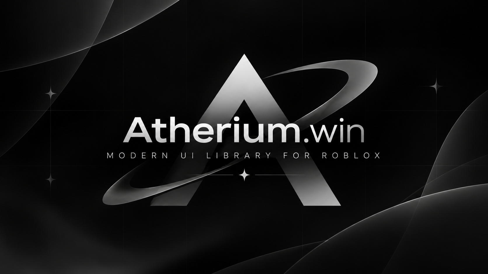
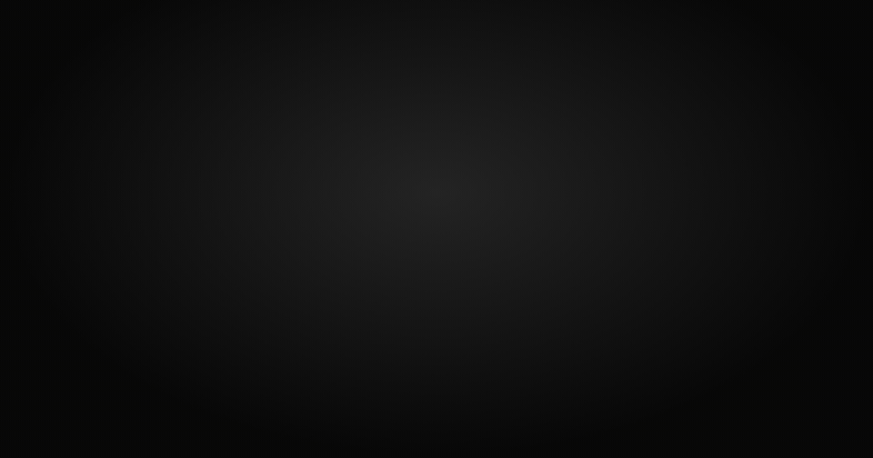

<p align="center">
  
</p>

<h1 align="center">Atherium UI</h1>

<p align="center">
  <b>A modern monochrome UI library for Roblox, built with Luau.</b><br>
  Sidebar tabs, live controls, 3D viewport, charts, keybinds and a floating watermark.
</p>

<p align="center">
  
  
  
  <a href="docs/API.md"></a>
  <a href="https://t.me/AtheriumWIN"></a>
</p>

---

## Overview

Atherium is a single-theme interface library for Roblox scripts. Flat cards,
hairline separators, Lucide icons and one accent color that you control. The
window ships with camera-tracked acrylic blur, snap dragging, resizing, a
searchable control list and full config save/load.

The whole library is one file with no third-party Luau dependencies - nothing to
install, nothing to build on your side.

<p align="center">
  
</p>

## Project layout

| Path | Contents |
| --- | --- |
| `VibeUI.lua` | The library. Generated, returns the `VibeUI` table. |
| `vibe_hub.lua` | Single-file demo: engine plus a ready-made showcase window. |
| `test_vibeui.lua` | Smoke test. Loads the published build and exercises the whole API. |
| `docs/API.md` | Full API reference: every control, option and method. |
| `docs/CHANGELOG.md` | Release history, newest first. |
| `tools/build_module.py` | Regenerates `VibeUI.lua` from `vibe_hub.lua`. |
| `assets/` | Brand images used by this page. |

## Install

```lua
-- 1. library module
local VibeUI = loadstring(game:HttpGet(
    "https://raw.githubusercontent.com/gfeee724-jpg/atheriumUI.win/refs/heads/main/VibeUI.lua"
))()

local win = VibeUI:CreateWindow({ Title = "My Hub" })
local tab = win:AddTab("Main", "house")
local sec = tab:AddSection("General", "sparkles")

sec:AddToggle({ Name = "ESP", Callback = function(on) print(on) end })
sec:AddSlider({ Name = "FOV", Min = 10, Max = 120, Default = 70 })
win:CreateWatermark()
```

```lua
-- 2. one-shot demo with the full showcase window
loadstring(game:HttpGet(
    "https://raw.githubusercontent.com/gfeee724-jpg/atheriumUI.win/refs/heads/main/vibe_hub.lua"
))()
```

```lua
-- 3. smoke test: prints pass/fail for every control and the live fps
loadstring(game:HttpGet(
    "https://raw.githubusercontent.com/gfeee724-jpg/atheriumUI.win/refs/heads/main/test_vibeui.lua"
))()
```

`RightShift` toggles the window, right-click the watermark for its segment menu.
The full API lives in [`docs/API.md`](docs/API.md).

## Requirements

- A Roblox executor with `loadstring`, `game:HttpGet` and `getgenv`.
- HTTP access for the icon set. Icons are fetched at runtime from the public
  Lucide collection ([`Footagesus/Icons`](https://github.com/Footagesus/Icons)),
  so a client without HTTP will render controls without glyphs. There are no
  third-party Luau libraries involved - that request is the only external
  dependency, and the UI itself is a single file.

## Updates

The interface is updated **every week**: new controls, polish passes and
performance work land on `main` continuously, and every release is documented in
[`docs/CHANGELOG.md`](docs/CHANGELOG.md).

- Check `VibeUI.Version` after loading; the current build is `10.1`.
- Raw links sit behind a CDN cache for a few minutes after a push, so if a
  control looks older than the changelog, re-fetch with a cache buster.

```lua
local URL = "https://raw.githubusercontent.com/gfeee724-jpg/atheriumUI.win/refs/heads/main/VibeUI.lua"
writefile("VibeUI.lua", game:HttpGet(URL .. "?v=" .. tostring(os.time())))

local VibeUI = loadstring(readfile("VibeUI.lua"))()
assert(VibeUI.Version == "10.1", "stale VibeUI.lua, re-download it")
```

## Telegram

Official channel: **[t.me/AtheriumWIN](https://t.me/AtheriumWIN)**

Release notes, previews, screenshots and every future update are published there
first. Weekly progress reports, sneaky previews and dev news land on the channel
before they reach this repository.

## Notes

- `getgenv().Atherium` exposes `{ Version, UI, Window, Watermark }` for other
  scripts. Names starting with `_` are private and may change.
- `VibeUI.lua` is generated, never edited by hand.

## Build

```
python tools/build_module.py            # regenerate VibeUI.lua
python tools/build_module.py --check    # regenerate and run the Lua checkers
```

The script copies `vibe_hub.lua` up to the demo marker, stamps
`VibeUI.Version` into the banner and appends `return VibeUI`.
